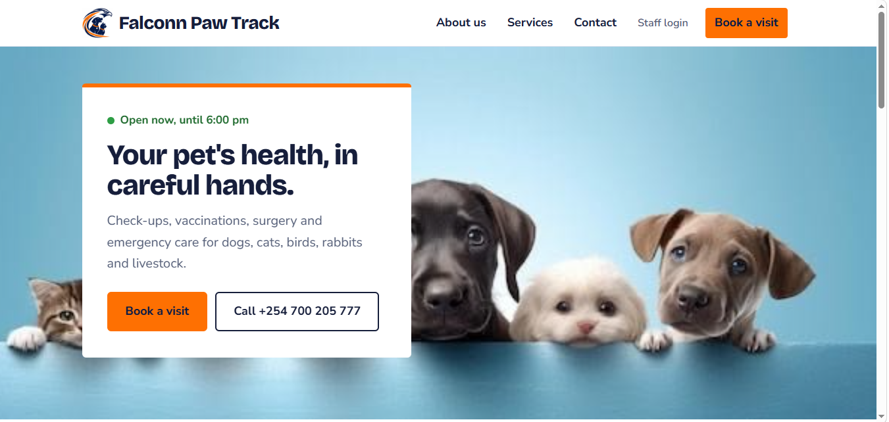
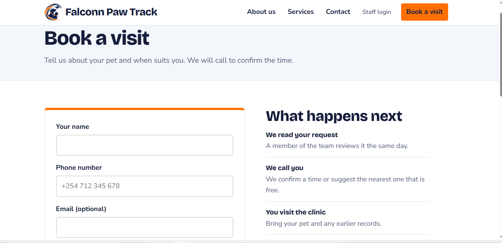
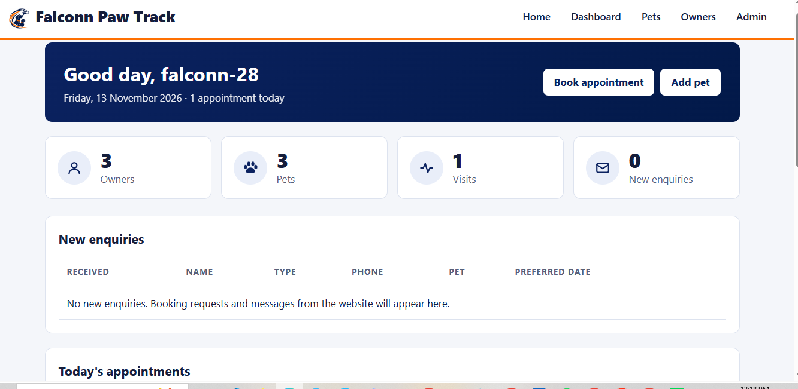
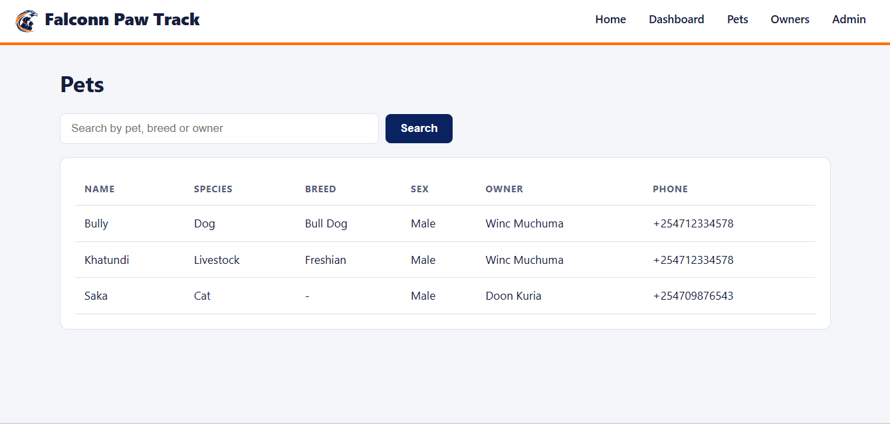

# Falconn Paw Track

*Care Today. Health Tomorrow.*

A veterinary clinic system built with Django. It has a public website where pet owners can read about the clinic and send booking requests, and a staff area where the front desk and vets manage owners, pets, appointments, visits and incoming enquiries.

Built as a portfolio project.

## Screenshots

> Add your screenshots to `docs/screenshots/` using the file names below.

| Public home page | Booking form |
|---|---|
|  |  |

| Staff dashboard | Pet list |
|---|---|
|  |  |

## Features

### Public website

- **Home, About us, Services and Contact pages** with a full-width hero photo and the clinic logo
- **"Open now" badge** that checks the current time in Nairobi against the clinic's opening hours
- **Book a visit form** that asks for the owner's details, the pet's name, a preferred date and the reason for the visit
- **Contact form** with the clinic's address, phone, email, opening hours and an embedded map
- **Form protection:** phone number and date checks, plus a hidden field that catches most spam bots
- **Responsive layout** that works on phones and desktops

### Staff area (login required)

- **Dashboard** with counts of owners, pets and visits, new website enquiries, today's appointments, recently added patients and follow-ups due in the next 7 days
- **Enquiries inbox:** every booking request and message from the website is saved, shown on the dashboard until a member of staff marks it as handled
- **Pet and owner lists** with search by name, breed, owner or phone number
- **Pet photos** uploaded from the admin, shown on the dashboard
- **Django admin** for managing owners, pets, appointments, visits, enquiries and staff accounts

## Data model

| Model | What it stores |
|---|---|
| **Owner** | Name, phone, email, address |
| **Pet** | Owner, name, species, breed, sex, date of birth, photo, notes |
| **Appointment** | Pet, vet (a staff user), date and time, reason, status (booked, completed or cancelled) |
| **Visit** | One per appointment: weight, temperature, diagnosis, treatment, medication, follow-up date, fee |
| **Enquiry** | Booking requests and messages from the public site, with a "handled" flag |

Vets are ordinary Django users with **Staff status** ticked.

## Built with

- Python and Django 5.2
- SQLite
- Pillow, for pet photo uploads
- Plain HTML and CSS, with no JavaScript framework
- Google Fonts: Bricolage Grotesque and Nunito Sans

## Getting started

### Requirements

- Python 3.10 or newer
- Git

### Installation

```bash
git clone https://github.com/Abira28/falconn-paw-track.git
cd falconn-paw-track
```

Create and activate a virtual environment.

On Windows:

```bash
python -m venv venv
venv\Scripts\activate
```

On macOS or Linux:

```bash
python3 -m venv venv
source venv/bin/activate
```

Install the packages, create the database and an admin account:

```bash
pip install -r requirements.txt
python manage.py migrate
python manage.py createsuperuser
```

Start the server:

```bash
python manage.py runserver
```

Then open:

| Address | What you will see |
|---|---|
| http://127.0.0.1:8000/ | The public website |
| http://127.0.0.1:8000/dashboard/ | The staff dashboard (asks you to log in) |
| http://127.0.0.1:8000/admin/ | The Django admin |

### Adding some data

The database starts empty. To see the dashboard working:

1. In the admin, add an **Owner**, then a **Pet** for that owner (upload a photo if you like).
2. Add a **User** with **Staff status** ticked, to act as a vet.
3. Add an **Appointment** for today, then a **Visit** with a follow-up date inside the next 7 days.
4. Send a message from the public Contact page and watch it appear on the dashboard.

Uploaded photos are saved in a `media/` folder, which is not stored in Git.

## Customising

- **Clinic details and opening hours:** edit the block at the top of `clinic/site_views.py`. The name, phone, email, address, hours and the services list all live there.
- **Colours:** change the variables at the top of `clinic/static/clinic/css/theme.css`.
- **Hero photo:** replace `clinic/static/clinic/img/hero.jpg` with a wide landscape photo you have the right to use.
- **Logo:** the files are in `clinic/static/clinic/img/`.

## Project structure

| Path | Purpose |
|---|---|
| `config/` | Project settings and main URLs |
| `clinic/models.py` | Owner, Pet, Appointment, Visit and Enquiry |
| `clinic/views.py` | Staff dashboard, pet list and owner list |
| `clinic/site_views.py` | Public pages, clinic details and opening hours |
| `clinic/forms.py` | Booking and contact forms with validation |
| `clinic/templatetags/` | Dashboard helper for new enquiries |
| `clinic/templates/clinic/` | Page templates |
| `clinic/static/clinic/` | CSS, logo and hero image |

## Roadmap

Not built yet:

- [ ] Deploy the site online
- [ ] Email alert when a new enquiry arrives
- [ ] Vaccination reminders by SMS
- [ ] Invoices and payments, including M-Pesa
- [ ] Pet detail pages with full visit history
- [ ] Automated tests

## Credits

- Photos:  "Photo from Unsplash".
- Fonts: [Bricolage Grotesque](https://fonts.google.com/specimen/Bricolage+Grotesque) and [Nunito Sans](https://fonts.google.com/specimen/Nunito+Sans), both under the SIL Open Font License.

## License

Copyright (c) 2026 Fredrick Abira. All rights reserved.

The source code is published for viewing as part of a portfolio. See the [LICENSE](LICENSE) file for details.
